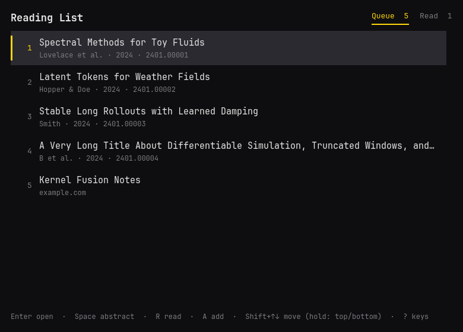

# readlist



A popup for your paper reading list. Open it, pick a paper, press Enter, and
the PDF opens in the browser. The list is a plain Markdown note (so it can
live in an Obsidian vault and sync), and a CLI lets agents add papers by
arXiv link with the real title fetched for them.

## Keys

| Key | Action |
|---|---|
| Enter | Open the paper (arXiv PDF) and close |
| Ctrl+Enter | Open the paper, stay open |
| Space | Show or hide the abstract (Up/Down keep browsing) |
| Up/Down, K/J | Select |
| Shift+Up/Down | Move the paper one place |
| Hold Shift+Up/Down | Move it to the top or bottom |
| R | Mark read (in Read: back to the queue) |
| A | Add a paper; prefilled from the clipboard |
| S, / | Search titles and authors; Esc clears |
| D, Delete | Remove |
| Tab | Switch between Queue and Read |
| Ctrl+Z, Ctrl+Shift+Z | Undo, redo |
| Esc, Q | Close |
| ? | Show the keys |

## The list file

The first line of `~/.config/readlist/path` (or `$READLIST_FILE`) names the
note; without it the list lives in `~/.local/share/readlist/Reading List.md`.
The app owns the `## Queue` and `## Read` sections:

```markdown
## Queue

- [ ] [Paper title](https://arxiv.org/abs/2204.07137) · added 2026-11-08
- [ ] https://arxiv.org/abs/2311.07222     <- a bare link gets its title fetched

## Read

- [x] [Another paper](https://arxiv.org/abs/2503.06623) · added 2026-11-01 · read 2026-11-08
```

Everything above `## Queue`, any later section, and lines it does not
recognise are kept as written. Ticking a box under Queue in Obsidian files the
paper under Read. Titles, authors, and abstracts are cached in
`~/.cache/readlist/`.

## CLI

```sh
readlist add 2204.07137 https://arxiv.org/abs/2311.07222 [--bottom] [--json]
readlist add <link> --title "Title"     # skip the fetch (PDFs, login walls)
readlist list [--read|--all] [--json]
readlist show <paper> [--json]
readlist read|unread|remove <paper>...
readlist move <paper> up|down|top|bottom|<position>
readlist open <paper>
readlist skill install [--dir ~/.claude/skills]
```

`<paper>` is an arXiv id, a link, or a queue position. Commands exit 0 or 1
with the reason on stderr.

## Build

```sh
bin/build      # build/readlist
bin/test       # unit tests, offscreen
bin/install    # makepkg -fsi: installs the app into the launcher
```
